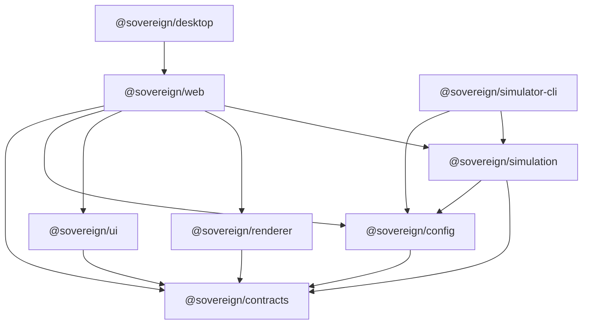

# Package dependency diagram

Arrows point from a package to what it is allowed to depend on. The graph is enforced by `tools/check-dependency-rules.mjs` (`pnpm lint:deps`, part of `pnpm lint` and of CI): it reads every `package.json` and every import in `src/` and `tests/`, and fails on anything the graph does not allow. The graph itself is pinned by a test, so an edge cannot be added without a change that says so.

## Rules

| Package         | May depend on                                         |
| --------------- | ----------------------------------------------------- |
| `contracts`     | nothing internal                                      |
| `config`        | `contracts`                                           |
| `simulation`    | `contracts`, `config`                                 |
| `renderer`      | `contracts`                                           |
| `ui`            | `contracts`                                           |
| `web`           | `simulation`, `renderer`, `ui`, `config`, `contracts` |
| `desktop`       | `web`                                                 |
| `simulator-cli` | `simulation`, `config`                                |

`web` also lists `config` and `contracts` because the app reads defaults and shares types directly.

## Who owns which library

| Library                        | Only in     |
| ------------------------------ | ----------- |
| `pixi.js`                      | `renderer`  |
| `react`, `react-dom`           | `ui`, `web` |
| `electron`, `electron-builder` | `desktop`   |

Test files are exempt from these library rules (they hold fixtures and use test tooling) but are held to the same `@sovereign/*` graph.

## Stricter rules for the engine

`@sovereign/simulation` has **no third-party runtime dependencies at all**: a library that sits under world generation is a library whose behaviour can change a world, so the noise, the PRNG and the math are the engine's own. Its `devDependencies` may only be development tooling. Its sources are additionally under the lint bans described in [simulation/determinism.md](../simulation/determinism.md).

A relative import may not climb out of its own package, and a package may not import another package's `src` by path: go through the package name.
